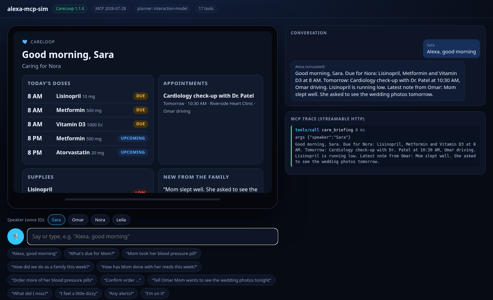
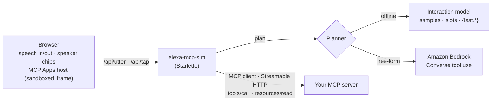

# alexa-mcp-sim

[](https://github.com/dohmnsama1-sketch/alexa-mcp-sim/actions/workflows/ci.yml)    [](LICENSE)

**An open-source, Echo Show-style voice simulator for any Streamable HTTP MCP server.** See and hear your MCP server the way an Alexa+ customer would, with voice, speaker profiles, screen cards, touch and a live protocol trace.

Alexa+ integrations are built on MCP, but Amazon's Alexa+ add-on tools (Category SDK, MCP Toolkit, CLI, Web Simulator) are in a closed partner preview. Everyone else building an Alexa+-style MCP server has no way to *hear and see* it the way a customer would. `alexa-mcp-sim` fills that gap in one command.



## Features

- **Voice in, voice out.** Push-to-talk speech recognition and spoken replies, using the browser's Web Speech API (Chrome or Edge). Typing works everywhere.
- **Speaker profiles.** Simulate Alexa voice ID: pick who is talking, and the planner passes it to your tools.
- **MCP Apps host.** Tools whose `_meta.ui.resourceUri` points at a `ui://` resource (`text/html;profile=mcp-app`) render on the simulated screen in a sandboxed iframe. The simulator answers `ui/initialize` and delivers `ui/notifications/tool-result`. Tools without a card get a plain response card.
- **Touch on cards.** Cards can call tools themselves through MCP Apps `tools/call`, for example a "Mark given" button. The host proxies the call to your server, fills in the current speaker (simulated voice ID) when the tool takes a `speaker` argument, and marks the call `(touch)` in the trace.
- **Live MCP trace.** Every `tools/call` with its arguments, result text, `isError` and latency.
- **Two planners:**
  - **Interaction model (offline, deterministic):** sample utterances with `{slots}`, like a classic Alexa interaction model, mapped to a tool and an argument template. Templates can use `{speaker}`, slots, and `{last.<tool>.<path>}` (values from earlier results), so multi-turn flows like "confirm order U Y F V" or "I'm on it" work with no LLM. Ideal for repeatable demos and CI.
  - **Amazon Bedrock (free-form):** Converse API tool use. Your MCP tools are offered as Bedrock tool specs and each `toolUse` runs against your server. `pip install "alexa-mcp-sim[bedrock]"` and set `AWS_REGION` and `SIM_BEDROCK_MODEL` (default `amazon.nova-pro-v1:0`).
- **Both MCP protocol eras.** Built on the official MCP Python SDK client: it probes 2026-07-28 `server/discover` and falls back to the 2025-11-25 `initialize` handshake. Bearer tokens are supported (`--token`).

## Quick start (under 60 seconds)

With [uv](https://docs.astral.sh/uv/), in two terminals, run a reference server and the simulator:

```bash
uvx --from git+https://github.com/dohmnsama1-sketch/careloop careloop --demo
uvx --from git+https://github.com/dohmnsama1-sketch/alexa-mcp-sim alexa-mcp-sim --model careloop
# open http://127.0.0.1:8787
```

For your own server: `alexa-mcp-sim --server http://127.0.0.1:PORT/mcp --model my-model.json`, or `--planner bedrock` for free-form requests.



`--model careloop` (bundled; also in `examples/careloop.json`) drives [CareLoop](https://github.com/dohmnsama1-sketch/careloop), a family-care MCP server. Write your own model:

```json
{"members": ["Sara", "Omar"],
 "intents": [{"name": "Briefing", "tool": "care_briefing", "args": {"speaker": "{speaker}"},
              "show": ["Alexa, good morning"], "samples": ["good morning", "how is {who} doing"]}]}
```

The most specific sample wins, because samples with more literal words are tried first. An intent with `"reply"` answers without a tool (for example, refusing "yes" when a confirmation code is required). `"needs_context"` is spoken when a `{last...}` value isn't available yet.

## Tests

```bash
pip install -e ".[test]" && pytest -q   # 21 tests: planner, Bedrock loop (stubbed Converse client), end-to-end over real HTTP incl. touch
# The end-to-end test runs against CareLoop when it is installed (CI installs it from GitHub).
```

Apache-2.0. Not affiliated with or endorsed by Amazon. "Alexa" and "Echo Show" are trademarks of Amazon; this tool simulates the experience for development only.
